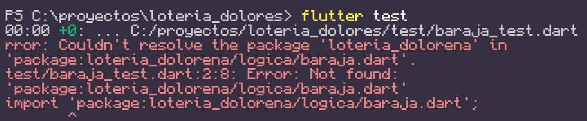
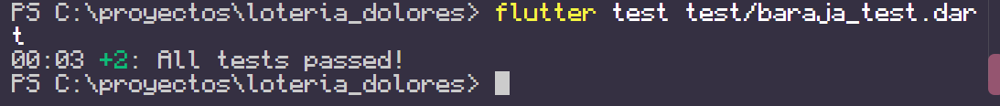
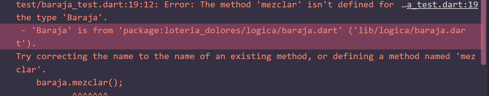
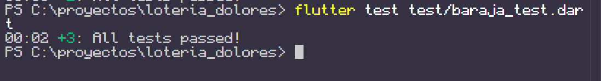
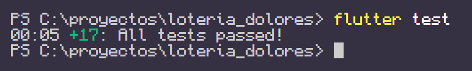
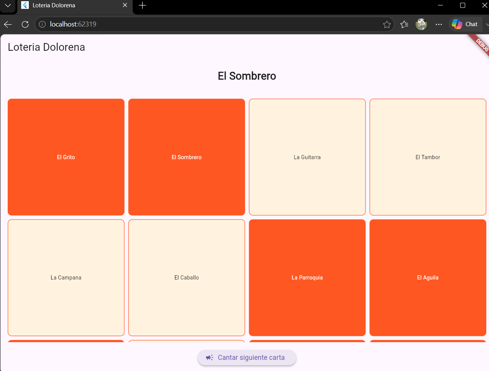
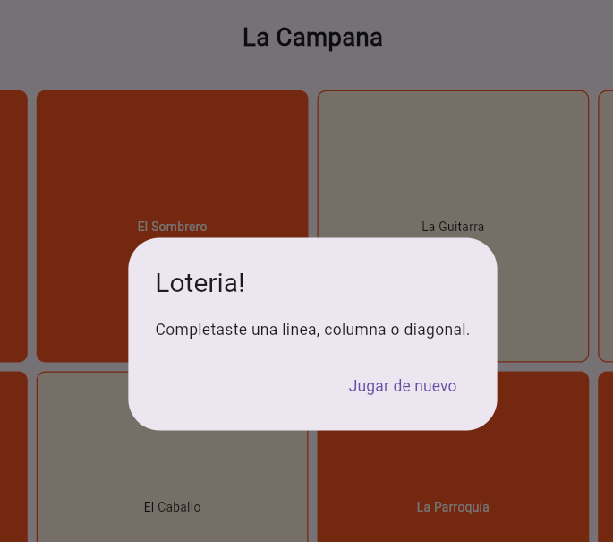

# 🃏 Lotería Doloreña (Desarrollo Móvil Integral - Práctica TDD)

Juego tradicional de la Lotería Mexicana con temática de Dolores Hidalgo y la Independencia, construido desde cero 100% guiado por pruebas unitarias (TDD) utilizando Flutter y Dart.

## 📋 Reglas del Juego
* La tabla es una cuadrícula de 4x4 con las 16 cartas temáticas en orden aleatorio[cite: 1].
* El sistema canta cartas una por una desde una baraja barajada[cite: 1].
* Se marca automáticamente la celda de la tabla si coincide con la carta cantada[cite: 1].
* ¡Se gana ("¡Lotería!") al completar cualquier fila, columna o diagonal completa[cite: 1]!

## 🛠️ Estructura del Proyecto
* **`lib/modelos/`**: Estructura de datos base de la carta[cite: 1] (con sobrecarga de operadores `==` y `hashCode` para comparación por ID).
* **`lib/logica/`**: Lógica de negocio pura en Dart[cite: 1] (Baraja, Tabla, Verificador de Patrones y Motor de Juego).
* **`lib/main.dart`**: Capa de interfaz gráfica de usuario en Flutter[cite: 1].
* **`test/`**: Pruebas unitarias y de integración para cada una de las rondas de TDD[cite: 1].

   ## 📸 Evidencia

### Pruebas Unitarias (`flutter test`)

### Aplicación Corriendo (`flutter run`)

